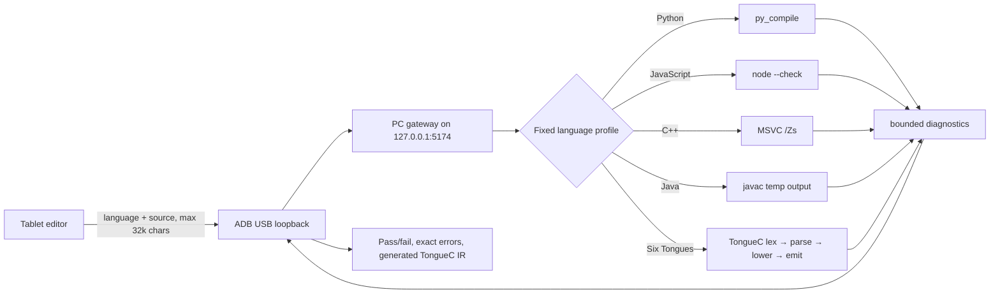

# Clay Compiler system map

## Purpose

Clay Compiler is a tablet-first learning surface for writing code and asking a real language toolchain whether it is structurally valid. It does not execute learner source. The existing project preview remains a separate browser sandbox for the HTML/CSS/JavaScript lessons.

## Data path

## Trust boundaries and invariants

- The PC service binds to `127.0.0.1`, never the LAN. ADB reverse exposes that loopback only to the attached tablet.
- The Android shell accepts navigation only to `http://127.0.0.1:5174` and disables file/content access and downloads.
- The request schema accepts one known language and at most 32,000 source characters. Null bytes and oversized output are rejected.
- Each check gets a new temporary directory. It is removed after success, rejection, timeout, or tool failure.
- Python uses `py_compile`; JavaScript uses `--check`; C++ uses `/Zs`. Java creates class files only inside the disposable directory. No checked program is launched.
- C++ permits only literal angle-bracket headers. Quoted/macro includes, parent traversal,
  `__has_include`, `#import`, `#using`, and include aliases are rejected before MSVC starts, so the
  preprocessor cannot be used to inspect arbitrary PC files.
- Six Tongues imports `C:\dev\tongue-compiler\tonguec.py`; it does not maintain a competing grammar or opcode table.
- Compiler children have hidden windows, redirected streams, a 15-second timeout, and a 48,000-character diagnostic limit.

## Product boundaries

The APK is a development shell, not a standalone on-device toolchain. It needs the USB connection and the headless PC service. This keeps the APK small and lets Python, Node, MSVC, Java, and TongueC use their installed canonical versions. A later offline edition would require separately reviewed Android-native/WASM toolchains and a storage budget.
